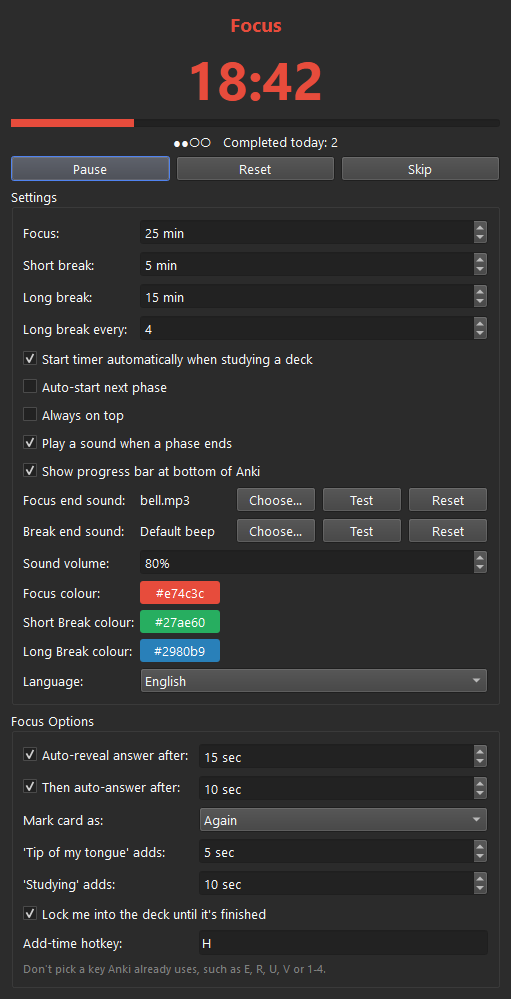
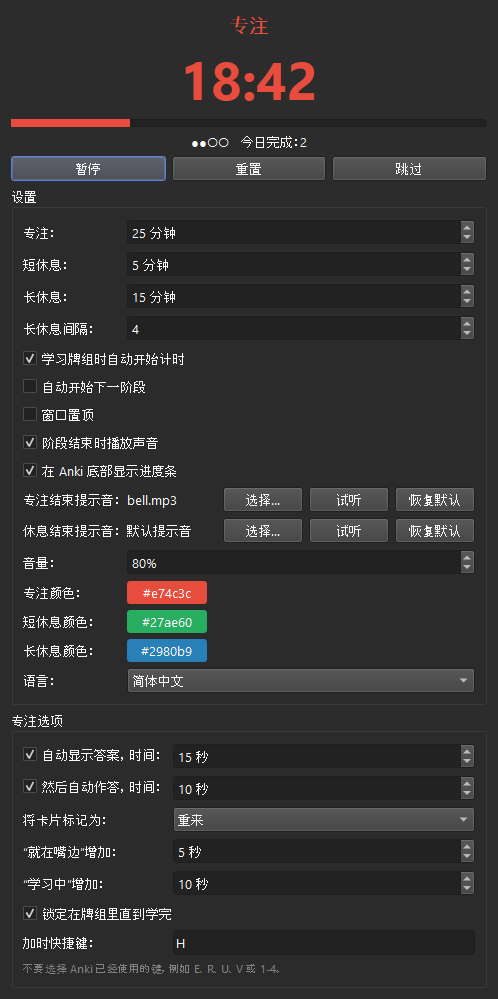

# Pomodoro Timer for Anki

An Anki add-on that adds a Pomodoro timer plus focus tools for reviewing.

 

## Features

- **Pomodoro timer** (Tools > Pomodoro Timer, `Ctrl+Shift+P`): focus / short break / long break,
  adjustable lengths, optional auto-start, a sound at the end of each phase (default beep or your own sound files, with volume), and a progress bar along the bottom of Anki.
  Starts automatically when you begin studying a deck (optional).
- **Auto-reveal**: shows the answer after a set number of seconds.
- **Auto-answer**: once the answer is showing, marks the card *Again* (or buries it) after a set time.
- **Tip of my tongue** button: adds a few seconds before the answer is revealed.
- **Studying** button: adds time before the card is auto-answered.
- **Add-time hotkey** (default `H`) for whichever of those two buttons is showing.
- **Lock me into the deck**: blocks going back to the Decks screen, the deck overview or
  switching decks until the deck's due cards are finished.
- Auto-reveal and auto-answer pause during breaks and while the Pomodoro is paused.
- While paused, the review screen shows **Resume** and **Continue without Pomodoro**
  (keeps the Pomodoro paused but turns auto-reveal / auto-answer back on).
- **Languages**: English, Español, Português, Français, Deutsch, 简体中文, 繁體中文, 日本語, 한국어.
  Follows Anki's language automatically (then the system language); can be set in Settings > Language.
  Translations live in [i18n.py](i18n.py).

All options are in the timer window under **Focus Options**; see [config.md](config.md) for the
config keys.

## Install

Copy this folder into Anki's add-ons folder (Tools > Add-ons > View Files), or zip
`__init__.py`, `i18n.py`, `manifest.json`, `config.json` and `config.md` into a `.ankiaddon` file and
install it from Tools > Add-ons > Install from file. Restart Anki afterwards.

Requires Anki 2.1.50 or newer.
